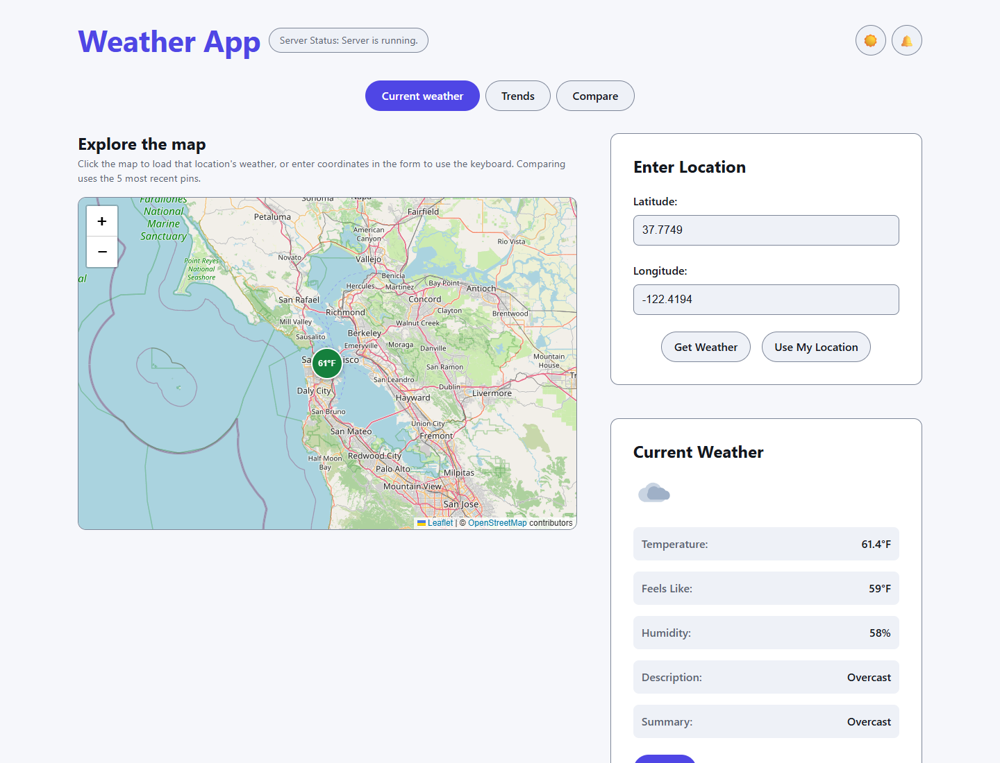
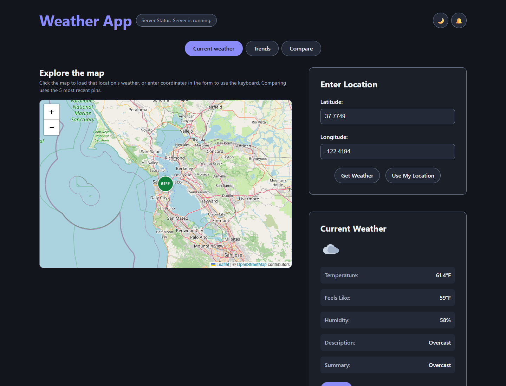
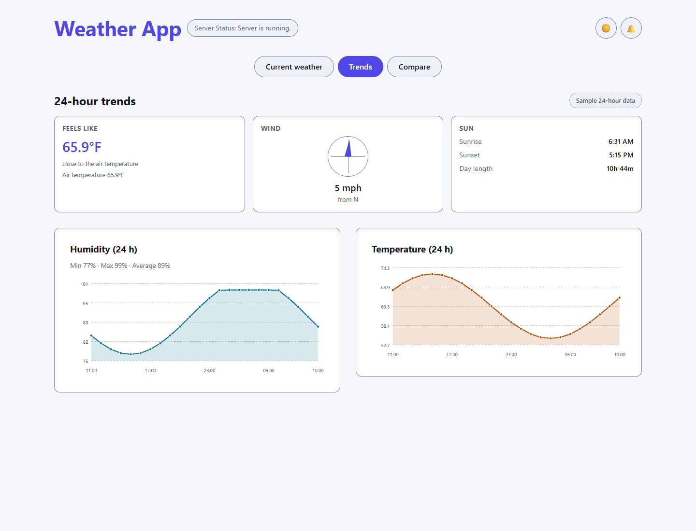
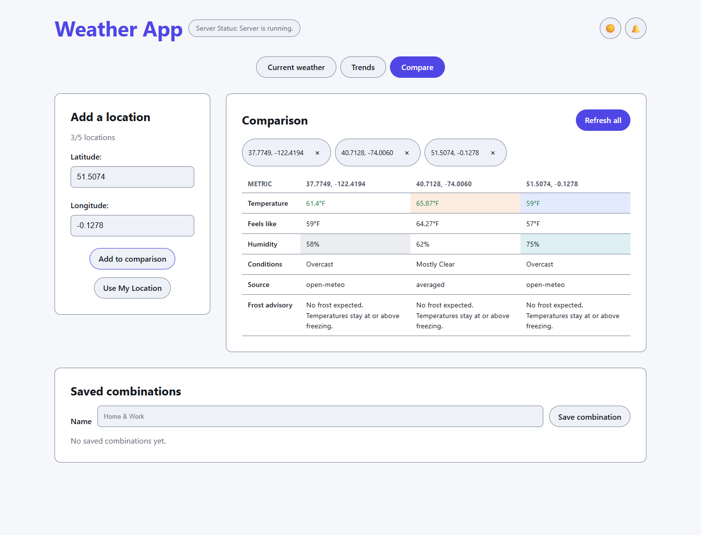
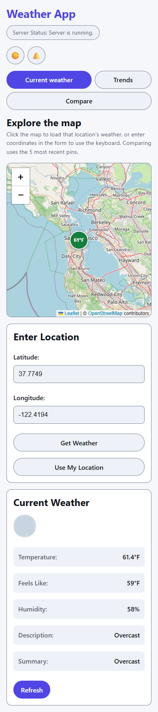

# Weather Service Application

A full-stack weather application with Spring Boot backend and React frontend that provides real-time weather information using the National Weather Service API.

[](https://github.com/amila-fc/weather-app/actions/workflows/backend-ci.yml)
[](https://github.com/amila-fc/weather-app/actions/workflows/frontend-ci.yml)
[](https://github.com/amila-fc/weather-app/actions/workflows/backend-ci.yml)
[](https://github.com/amila-fc/weather-app/actions/workflows/frontend-ci.yml)

## Screenshots

Captured from the running app (Vite dev server on `:3000`, backend on `:8080`) with Playwright driving Chrome at
1440×1100 and 390×844.

### Current weather — light and dark themes

<p>
  
  
</p>

### 24-hour trends



### Location comparison



### Mobile layout



## Coding Exercises

**See [EXERCISE.md](EXERCISE.md) for coding challenges including:**
- Backend exercises (caching, multiple weather services, historical data)
- Frontend exercises (map visualization, comparison tools, notifications)
- Full-stack exercises (user preferences, data export, monitoring)
- Advanced challenges (predictions, i18n, real-time updates)

## Quick Start

### Prerequisites
- Java 21
- Node.js 20+ (auto-installed by Gradle)
- Gradle 9.3+ (use the included wrapper)

### Building & Running

#### Option 1: Using Gradle Wrapper (Recommended)

```bash
# Build the entire application (frontend + backend)
./gradlew build

# Run the Spring Boot application (includes frontend)
./gradlew :backend:bootRun

# Or run with the JAR file
java -jar backend/build/libs/backend-0.0.1-SNAPSHOT.jar
```

#### Option 2: Development Mode

```bash
# Terminal 1: Run backend
./gradlew :backend:bootRun

# Terminal 2: Run frontend dev server (with hot reload)
./gradlew :frontend:npmDev
```

### Accessing the Application

- **Application**: http://localhost:8080
- **API Status**: http://localhost:8080/api/status
- **Weather API**: http://localhost:8080/api/weather?lat=40.7128&long=-74.0060

## Project Structure

```
weather-app/
├── backend/                 # Spring Boot application
│   └── src/
│       ├── main/java/      # Java source code
│       └── test/            # Unit tests
├── frontend/                # React application
│   └── src/
│       ├── api/            # API client
│       └── components/     # React components
├── EXERCISE.md             # Coding challenges
├── CLAUDE.md              # AI assistant instructions
└── build.gradle.kts       # Root build configuration
```

## Technology Stack

### Backend
- Spring Boot 3.3.6
- Java 21
- National Weather Service API (no API key required)
- Gradle build system

### Frontend
- React 18.3 with TypeScript
- Vite build tool
- TanStack Query for data fetching
- Tailwind CSS for styling

## API Documentation

### Endpoints

#### `GET /api/status`
Health check endpoint
- **Response**: `"Server is running."`

#### `GET /api/weather`
Get current weather data
- **Parameters**:
  - `lat` (required): Latitude
  - `long` (required): Longitude
- **Response**:
```json
{
  "temperature": 55.796,
  "humidity": 67.995,
  "description": "Clear",
  "apparentTemperature": 55.796,
  "summary": "Clear skies..."
}
```

## Testing

### Backend (JUnit 5 + JaCoCo)

```bash
# Run the backend suite; the JaCoCo report is generated automatically (finalizedBy jacocoTestReport)
./gradlew :backend:test -x :frontend:npmBuild

# Run a single test class
./gradlew :backend:test --tests "com.sample.weatherservice.controller.WeatherControllerTest" -x :frontend:npmBuild
```

Coverage output:

- `backend/build/reports/jacoco/test/html/index.html` — browsable report
- `backend/build/reports/jacoco/test/jacocoTestReport.xml` / `.csv` — machine readable, consumed by CI
- `backend/build/reports/tests/test/index.html` — test results

### Frontend (Vitest + Testing Library)

```bash
cd frontend
npm ci
npm test              # unit + component tests
npm test -- --coverage    # same suite with V8 coverage → frontend/coverage/
npm run test:coverage     # shortcut for the line above (when the provider is installed)
npm run lint
npm run build         # tsc && vite build
```

Coverage output: `frontend/coverage/coverage-summary.json`, `frontend/coverage/lcov.info` and
`frontend/coverage/index.html`.

### Coverage badges

The two coverage badges are rendered by shields.io from JSON files on the **`badges`** branch
(`backend-coverage.json`, `frontend-coverage.json`). The CI workflows regenerate them from the JaCoCo CSV and
the Vitest `coverage-summary.json` with `.github/scripts/coverage-badge.mjs`, then publish them with
`.github/scripts/publish_badges.sh`. The same script also supports an SVG badge if shields.io is unavailable:

```bash
node .github/scripts/coverage-badge.mjs \
  --source jacoco \
  --input backend/build/reports/jacoco/test/jacocoTestReport.csv \
  --name backend --label "backend coverage" --output-dir coverage-badges
# → coverage-badges/backend-coverage.json + backend-coverage.svg
```

## Continuous integration

Two GitHub Actions workflows run on every push and pull request to `main` (and can be started manually with
*Run workflow*):

| Workflow | Steps | Badge |
| --- | --- | --- |
| [`backend-ci.yml`](.github/workflows/backend-ci.yml) | JDK 21 (Temurin), Gradle wrapper validation, `./gradlew :backend:test -x :frontend:npmBuild` with JaCoCo, coverage table in the run summary, `backend-reports` artifacts, publishes the backend coverage badge on `main` | `Backend CI`, `backend coverage` |
| [`frontend-ci.yml`](.github/workflows/frontend-ci.yml) | Node 22, `npm ci`, `npm run lint`, `vitest run --coverage` (V8, installs the provider if the checkout predates it), `npm run build`, coverage table in the run summary, `frontend-reports` artifacts, publishes the frontend coverage badge on `main` | `Frontend CI`, `frontend coverage` |

The backend job skips `:frontend:npmBuild` (the `processResources` dependency) on purpose: the Vite build is
owned by the frontend job, so the two suites run in parallel and neither waits on the other.

### Enabling the workflows (one-time setup)

1. **Enable Actions** — *Settings → Actions → General → Allow all actions and reusable workflows*. This
   repository already has Actions enabled.
2. **Allow the workflow token to write** — *Settings → Actions → General → Workflow permissions →*
   **Read and write permissions**, then save. This is only needed for the badge publish step; without it the
   tests still run and the step is skipped (it is marked `continue-on-error: true` and the run stays green).
3. **Keep the `badges` branch** — it is an orphan branch that only holds generated badge files. Recreate or
   reseed it with:
   ```bash
   git checkout --orphan badges
   git rm -rf --cached .
   echo '{"schemaVersion":1,"label":"backend coverage","message":"87.3%","color":"green"}' > backend-coverage.json
   echo '{"schemaVersion":1,"label":"frontend coverage","message":"pending","color":"lightgrey"}' > frontend-coverage.json
   git add backend-coverage.json frontend-coverage.json
   git commit -m "chore: seed coverage badges"
   git push -u origin badges
   ```
   CI overwrites both files on every push to `main`; a missing report only produces a warning, never a failure.
4. *(Optional)* Protect `main` and require the two checks before merging:
   `Backend CI / Tests and coverage` and `Frontend CI / Lint, tests, coverage and build`. Leave `badges`
   unprotected — it only contains generated files.
5. *(Optional)* For a private fork, shields.io cannot read the `badges` branch; either reference the generated
   SVG files with a relative path (`badges/backend-coverage.svg`) or switch to a coverage service.

Prerequisite for the badge step: `<owner>/<repo>/badges` must exist (step 3) and the workflow must run on
`main` — pull-request runs never publish badges.

## Building for Production

```bash
# Clean build
./gradlew clean build

# The JAR file includes the frontend assets
# Deploy: backend/build/libs/backend-0.0.1-SNAPSHOT.jar
```

## Getting Started with Exercises

1. Review the exercises in [EXERCISE.md](EXERCISE.md)
2. Choose a story to implement
3. Create a new branch for your work
4. Run tests to verify your implementation
5. Submit your solution

## License

This project is available for educational purposes.